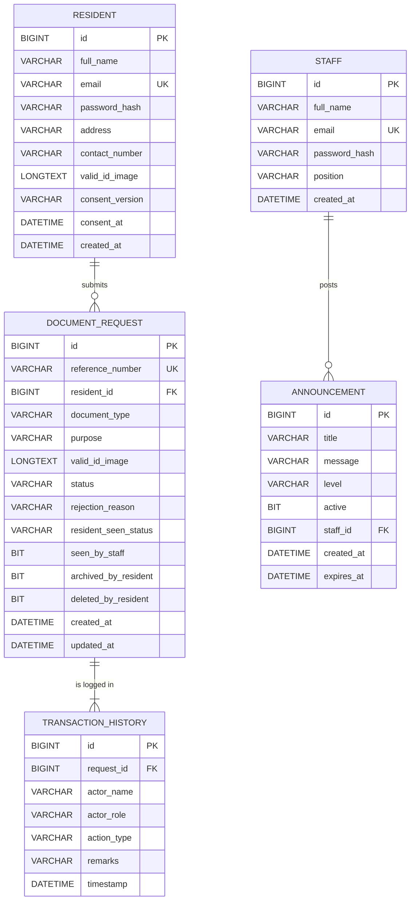

# Entity Relationship Diagram

MySQL database `brgy_labangon`. Tables are created by Hibernate from the classes in
`backend/src/main/java/ph/brgylabangon/docrequest/entity/`.

## Relationships

| Relationship | Type | Foreign key |
|---|---|---|
| A resident submits document requests | 1 to many (0..*) | `document_request.resident_id` -> `resident.id` |
| A request is logged in the transaction history | 1 to many (1..*) | `transaction_history.request_id` -> `document_request.id` |
| A staff member posts announcements | 1 to many (0..*) | `announcement.staff_id` -> `staff.id` |

## Allowed values

- `document_request.status`: PENDING, PROCESSED, READY_FOR_PICKUP, RELEASED, REJECTED, CANCELLED
- `announcement.level`: URGENT, IMPORTANT, INFO
- `transaction_history.action_type`: SUBMITTED, UPDATED, CANCELLED, PROCESSED, READY_FOR_PICKUP, RELEASED, REJECTED

To draw it for the documentation: MySQL Workbench > Database > Reverse Engineer > pick `brgy_labangon`.
